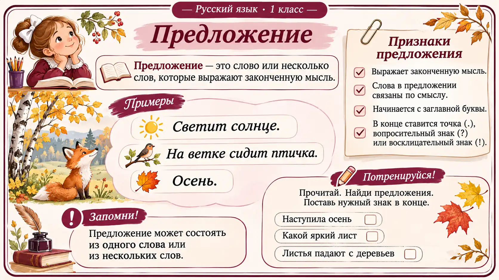
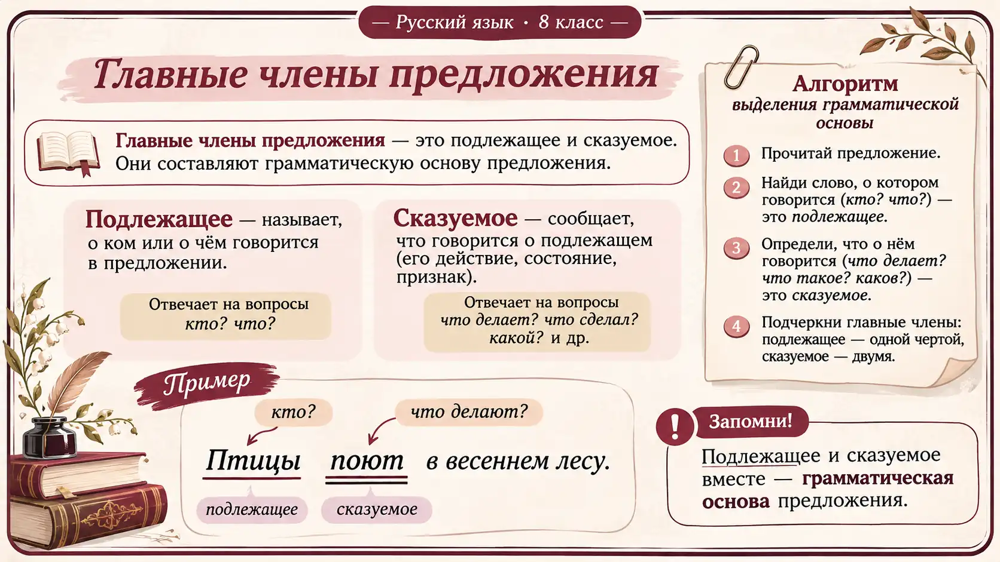

# Иллюстрированные изображения (созданы генерацией изображений)

Здесь хранятся **настоящие растровые изображения WebP**, созданные генератором изображений, а не текстовые таблицы или автоматически сформированные SVG-схемы.

## Первый класс — «Предложение»

[Открыть изображение](grade-1/ru-1-015.webp)

## Восьмой класс — «Главные члены предложения»

[Открыть изображение](grade-8/ru-8-009.webp)

## Статус

- В этой папке **2** изображения, созданных непосредственно как иллюстрации (1672 × 941).
- [Старые 267 SVG-схем](../illustrated/) — другой тип материалов; они **не считаются** законченными иллюстрациями в стиле, показанном выше.
- Перед использованием на уроке необходима окончательная вычитка текста, орфографии, грамотности схем и соответствия уровню класса.
- При расширении комплекта следует создавать **новый предметный рисунок для каждой темы**, а не накладывать одно и то же оформление на автоматически собранные таблицы.

Исходные учебные темы: `frp_tasks/ru.json`. Исходный смысл не следует автоматически заменять непроверенными правилами.
